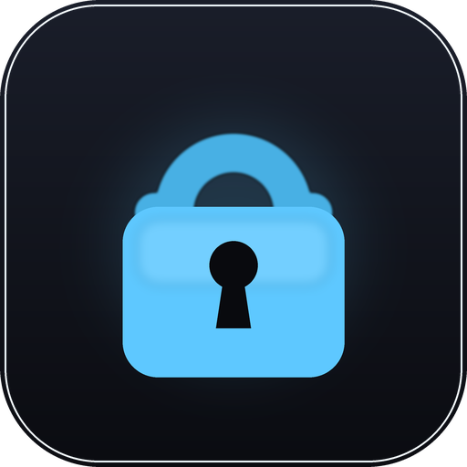
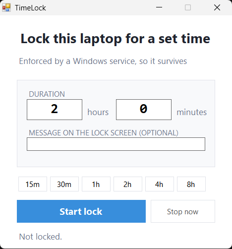
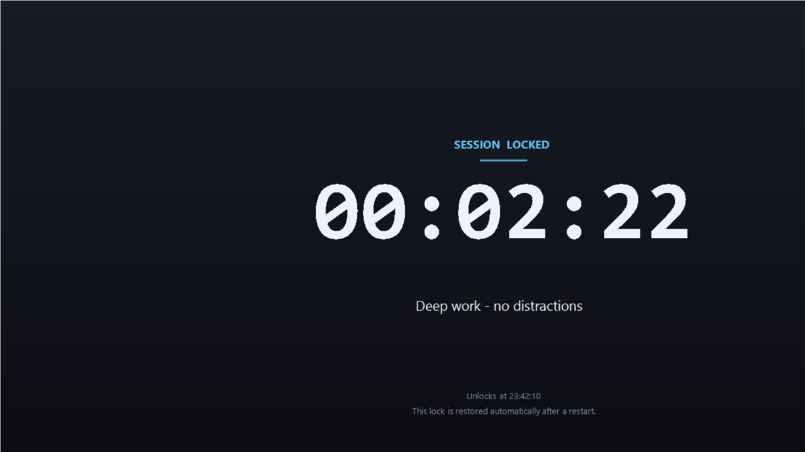
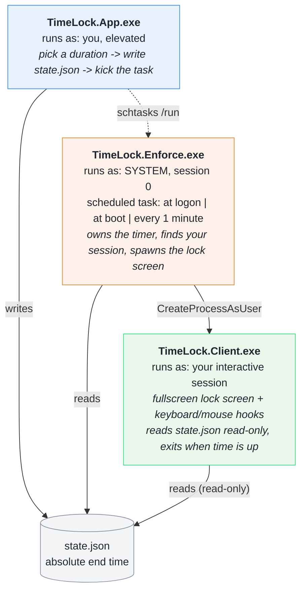

<div align="center">



# TimeLock

**A timed lock for your Windows laptop that survives restarts.**

Choose a duration, press one button, and the machine is locked until the timer
runs out — through reboots, sleep, and closing the app.

No installers. No .NET SDK. No third-party tools.
It compiles with the C# compiler that already ships inside Windows.

[](https://github.com/tamimlabs/TimeLock/actions/workflows/build.yml)
[](LICENSE)


</div>

---

<p align="center">
  
  &nbsp;&nbsp;&nbsp;
  
</p>

---

## Contents

- [Download and run](#download-and-run)
- [What it does](#what-it-does)
- [What it does *not* stop](#what-it-does-not-stop) ← **read this first**
- [How it works](#how-it-works)
- [Design notes](#design-notes)
- [Verified behaviour](#verified-behaviour)
- [Troubleshooting](#troubleshooting)
- [Contributing](#contributing)
- [License](#license)

---

## Download and run

### Option 1 — download the zip (no tools needed)

1. Go to **[releases](https://github.com/tamimlabs/TimeLock/releases)** and
   download the latest `TimeLock-v*.zip`.
2. Extract it anywhere (Desktop is fine).
3. **Double-click `install\Install.cmd`** and accept the administrator prompt.
4. Open **TimeLock** from the Start Menu, pick a duration, press **Start lock**.

To remove it later: double-click `install\Uninstall.cmd`.

> Windows may show a SmartScreen "unrecognized publisher" warning. Choose
> **More info → Run anyway**. That appears for any program that isn't
> code-signed.

### Option 2 — one line from PowerShell

Run this in **PowerShell as Administrator**. It downloads the latest release,
extracts it and installs:

```powershell
$ProgressPreference = 'SilentlyContinue'
$zip = "$env:TEMP\TimeLock.zip"
Invoke-WebRequest "https://github.com/tamimlabs/TimeLock/releases/latest/download/TimeLock-latest.zip" -OutFile $zip
$dir = "$env:TEMP\TimeLock"
Remove-Item $dir -Recurse -Force -ErrorAction SilentlyContinue
Expand-Archive $zip $dir -Force
& "$dir\install\Install.ps1"
```

### Option 3 — clone and build it yourself

You only need Windows; no Visual Studio, no .NET SDK, no NuGet, no `dotnet`
CLI. The project compiles with the C# compiler that already ships inside
Windows.

```
git clone https://github.com/tamimlabs/TimeLock.git
cd TimeLock
build.cmd
powershell -ExecutionPolicy Bypass -File install\Install.ps1
```

Or on one line from PowerShell:

```powershell
git clone https://github.com/tamimlabs/TimeLock.git
cd TimeLock
.\build.cmd
.\install\Install.ps1
```

**Where things get installed**

| Path | What |
| --- | --- |
| `C:\Program Files\TimeLock\` | the three executables |
| `C:\ProgramData\TimeLock\state.json` | the lock timer (read-only for normal users) |
| Scheduled task `TimeLock.Enforce` | runs as `SYSTEM` at logon, at boot, and every minute |
| Start Menu + Desktop | a **TimeLock** shortcut |

After installing, open **TimeLock** from the Start Menu.

---

## What it does

- Locks the whole screen, spanning **all monitors**.
- A **live countdown** you can read at a glance, with the unlock time.
- **Survives restart.** The lock is anchored to an absolute wall-clock end time,
  so restarting mid-lock gives you the *remaining* time, not a fresh one.
- **Enforced by a Windows scheduled task running as `SYSTEM`**, not by a window
  you can just close.
- **Resists the obvious escapes**: `Win`, `Alt+Tab`, `Ctrl+Shift+Esc`,
  `Win+R`, `Win+X`, taskbar right-click, and `Win+Ctrl+D` new desktop.
- **Always comes back.** The desktop, taskbar and shell policy are restored the
  moment the timer ends — even if you kill the lock screen mid-lock.
- **Optional message** shown on the lock screen.
- One `.exe` per component, all tiny, all removable.

## What it does *not* stop

Please read this section before filing a bug. Most "my lock is broken" reports
are one of these.

**Cannot be blocked by any user-mode application on Windows:**

| Escape | Why |
| --- | --- |
| **Ctrl+Alt+Del** | The Secure Attention Sequence is handled by the kernel and is never passed to applications. From it you can switch user, sign out, or shut down. |
| **Safe Mode** | Boots a minimal driver set and ignores your scheduled task. |
| **Holding the power button** | Turns the machine off instantly. |
| **Unplugging / battery** | The lock resumes when power returns — but so does your freedom to act. |
| **Recovery environment / USB boot** | Unless BitLocker is on (a Pro feature). |

**Possible if you actively work at it:**

- **A second Windows account.** The lock covers sessions that exist at the time;
  signing in as someone else creates a new session.
- **Remote Desktop**, if you have it enabled.
- **Uninstalling it.** You are an administrator; `Uninstall.ps1` will do it for
  you, on request.

**One subtle one worth knowing:** a *higher-privilege process injecting
synthetic keystrokes* can slip past the keyboard hook, because UIPI stops a
medium-integrity hook from observing input injected by an elevated process.
Your own fingers cannot do this.

### If you need it genuinely unbreakable

Windows 11 **Pro** adds **Assigned Access** (kiosk mode). It is enforced by the
OS itself and is not defeatable by the logged-in user — no administrator
token, no safe mode, no recovery environment. The upgrade is $99 and it is the
only real answer to "there should be no way to open this normally."

TimeLock is a **focus tool**, not a security product. It raises the cost of
impulse and survives the things you would do while irritated. It does not
defend a machine from someone who is genuinely set on getting in.

---

## What the installer does

**Requirements:** Windows 10 or 11. Nothing else — no SDK, no runtime, no
third-party tools.

| Step | Detail |
| --- | --- |
| Copies binaries | to `C:\Program Files\TimeLock` |
| Prepares data | `C:\ProgramData\TimeLock\state.json` |
| Locks down ACLs | `BUILTIN\Users` gets **read-only**; only `SYSTEM` and admins can write |
| Registers the task | `TimeLock.Enforce` — runs as `SYSTEM`, at logon, at boot, and every minute |
| Restores shell policy | puts `Winlogon\AutoRestartShell` back to `1` |
| Adds shortcuts | Start Menu and Desktop |

It is safe to run more than once.

Uninstalling removes the scheduled task, the program folder, the shortcuts and
the shell-policy change, then asks whether to delete your settings and logs.

---

## How it works

Three executables:



The client has **no way to extend or cancel** the lock: it only reads
`state.json`, which normal users cannot write.

State is one file, `C:\ProgramData\TimeLock\state.json`:

```json
{
  "Enabled": true,
  "EndUtcTicks": 639274204613515318,
  "CreatedUtcTicks": 639274203713515318,
  "DurationSeconds": 7200,
  "Message": "Deep work"
}
```

---

## Design notes

### The countdown is a timestamp, not a counter

This is the single most important decision in the project.

A countdown stored as "1:47:33 remaining" can be paused by rebooting, stretched
by suspending, or corrupted by a crash. Storing an **absolute end time** means
every process independently agrees on when the lock ends, and no sequence of
crashes, reboots or clock games can move it.

The consequences are all good:

- Reboot at the halfway point → you get the remaining half.
- Kill every lock screen → the enforcer still knows when time is up.
- There is no local state to drift out of sync with what is enforced.

`IsActive` is `Enabled && EndUtcTicks > UtcNow`. Nothing else decides whether
you are locked.

### The shell gets killed, not just the keys

A keyboard hook alone is a weak defence — it is user-mode, and it only sees
input routed through the queue. So during a lock, TimeLock also removes the
thing that owns all the interesting shortcuts:

- `explorer.exe` is terminated in every user session.
- `HKLM\...\Winlogon\AutoRestartShell` is set to `0`.

`explorer.exe` owns **`Win+Ctrl+D`** (new desktop), **`Win+Ctrl+Left/Right`**
(virtual desktop switching), the taskbar, and desktop right-click menus. With it
gone, those shortcuts do not exist.

Killing explorer once is not enough — Winlogon respawns it in about a second.
That is precisely why `AutoRestartShell` exists and why it is flipped. Both are
restored when the lock ends.

The lock screen itself is an ordinary top-level window, so it survives explorer
being gone.

> **This is the fix for the "I opened a new desktop" bypass.** Found the hard
> way: the keyboard hook *does* block `Win+Ctrl+D`, but relying on a single
> user-mode defence for something this central is the wrong design.

### Fail open, never closed

This is a focus tool, and it must never be able to brick a machine.

| Situation | Result |
| --- | --- |
| State file missing / empty / corrupt | Treated as **unlocked** |
| Lock found finished but untidy | Enforcer rewrites a clean "off" state |
| `AutoRestartShell` was changed | Restored to its original value |
| explorer missing, no active lock | Enforcer relaunches it |
| Duration requested | Capped at 72 hours |
| Client crashes mid-lock | Enforcer respawns it within a minute |
| Enforcer itself is killed | The one-minute trigger restarts it |

### Permissions

The data folder is readable by `BUILTIN\Users` and writable only by `SYSTEM` and
administrators. The lock client runs unprivileged and therefore **cannot** cancel
or extend a lock — it can only display one and step aside when the end time
passes. That is why the enforcer exists as a separate `SYSTEM` process.

### Code layout

```
Locker/
├── build.cmd                     compiles all three .exe files
├── src/
│   ├── Common.cs                 state store, paths, Win32 interop, session enumeration
│   ├── Client.cs                 lock screen + input hooks
│   ├── Enforcer.cs               SYSTEM watchdog, shell suppression
│   ├── App.cs                    the duration window
│   └── app.manifest              requests admin for App.exe
├── install/
│   ├── Install.ps1               files, ACLs, scheduled task, shortcuts
│   └── Uninstall.ps1             removes all of it
├── tools/
│   └── make_logo.py              generates every image in assets/ and docs/
├── assets/                       icon + multi-resolution .ico
├── docs/                         screenshots and logos
└── bin/                          build output (git-ignored)
```

Targets **C# 5 / .NET Framework 4.x** — the only thing `csc.exe` supports out
of the box. No `?.`, no string interpolation, no expression-bodied members.

There is no hand-drawn artwork in the repository. `tools/make_logo.py`
(Pillow) generates the icon, the `.ico` and both README lockups, so the mark
can be re-rendered or tweaked in one place:

```
py -3 tools\make_logo.py
```

> The README header uses `assets/timelock.png` on its own rather than a
> `<picture>` block with a light/dark pair. GitHub renders `<picture>` fine,
> but several Markdown previews strip the `<source>` element and show nothing at
> all — and the icon reads clearly on both light and dark backgrounds anyway.
> `docs/logo-light-bg.png` and `docs/logo-dark-bg.png` are still generated if
> you want the horizontal lockup for a social preview or a docs site.

`build.cmd` uses `assets\timelock.ico` if it exists and quietly skips the
`/win32icon` switch if it does not, so a clone that skipped the asset step
still builds.

---

## Verified behaviour

Tested on Windows 11 Home Single Language, build 26220, 1536×864 at 125% scaling:

| Check | Result |
| --- | --- |
| Lock screen appears after starting a lock | ~4s |
| `Win+Ctrl+D`, `Alt+Tab`, `Ctrl+Shift+Esc` | Blocked — Task Manager did not open |
| `explorer.exe` during a lock | Terminated, stays down |
| `Winlogon\AutoRestartShell` during a lock | `0` |
| Lock ends on schedule | Client exited within 3s of the deadline |
| Desktop + taskbar after unlock | Restored automatically |
| `AutoRestartShell` after unlock | Back to `1` |
| `state.json` after unlock | Normalised to `Enabled:false` |
| Standard user writing `state.json` | Denied |

Reboot persistence is implemented by design (absolute end time + logon/boot
triggers) but has **not** been exercised across a real reboot cycle. If you test
it, please open an issue with what you found either way.

---

## Troubleshooting

**The lock screen never appeared.**
Open an admin prompt and run `TimeLock.Enforce.exe --status`. It prints the state,
remaining time and which sessions it is locking. `C:\ProgramData\TimeLock\enforcer.log`
records each spawn attempt and why it failed.

**Keyboard shortcuts still work.**
Check `explorer.exe` is actually gone during a lock. If it is running, the
enforcer may be dead — `schtasks /query /tn TimeLock.Enforce` should show the
task registered as `SYSTEM`.

**No taskbar after unlocking.**
`Winlogon\AutoRestartShell` should be `1`. The enforcer restores it and
relaunches explorer within a minute even if it was killed. Setting the value
back to `1` manually and running `explorer.exe` fixes it immediately.

**The window looks wrong on a scaled display.**
Both Windows and TimeLock use per-monitor DPI awareness. If something is
clipped, `TimeLock.App.exe --dump` writes every control's real rectangle to
`%TEMP%\TimeLockDump.txt` — attach it to a bug report.

**Where are the logs?**

| File | Contents |
| --- | --- |
| `C:\ProgramData\TimeLock\enforcer.log` | Spawns, shell suppression |
| `%LOCALAPPDATA%\TimeLock\client.log` | Hook installation and the first few intercepted keystrokes |

The client writes to its own profile because the data folder is deliberately
read-only for normal users.

---

## Contributing

See [CONTRIBUTING.md](CONTRIBUTING.md). In short: `build.cmd`, then break it on
Windows before you open a PR — kill the lock screen, kill the enforcer, reboot
mid-lock, and let a lock expire to confirm the desktop comes back.

Security reports should not be public issues — see [SECURITY.md](SECURITY.md).

## License

[MIT](LICENSE).
